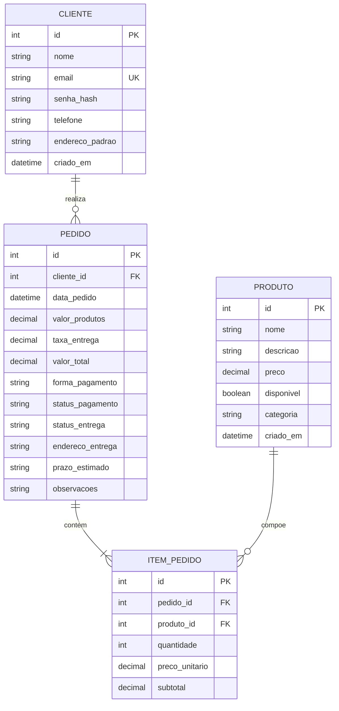

# Projeto de Banco de Dados — Loja de Cupcakes Gourmet

> Projeto Integrador Transdisciplinar em Engenharia de Software II. Modelagem de dados concebida a partir das classes de persistência, normalizada na Terceira Forma Normal (3FN), com script físico e dicionário de dados.

---

## 1. Modelo Conceitual de Dados

O modelo conceitual representa as entidades do negócio, seus atributos essenciais e as regras de relacionamento:

- **Cliente**: Representa o usuário que se cadastra, acessa a loja e realiza compras.
- **Produto (Cupcake)**: Representa os itens do catálogo gastronômico disponíveis para compra.
- **Pedido**: Representa a transação comercial formalizada pelo cliente, contendo dados de pagamento, entrega e status.
- **ItemPedido**: Entidade associativa que resolve o relacionamento N:M entre *Pedido* e *Produto*, registrando a quantidade comprada e congelando o preço unitário praticado no momento da venda.

### Cardinalidades e Relacionamentos:
- **Cliente (1) ---- (0..N) Pedido**: Um cliente pode realizar zero ou vários pedidos; cada pedido pertence obrigatoriamente a um único cliente.
- **Pedido (1) ---- (1..N) ItemPedido**: Um pedido é composto obrigatoriamente por um ou mais itens; cada item pertence exclusivamente a um único pedido.
- **Produto (1) ---- (0..N) ItemPedido**: Um produto pode estar presente em zero ou vários itens de pedidos; cada registro de item refere-se obrigatoriamente a um único produto do catálogo.

---

## 2. Modelo Lógico Normalizado (3FN)

O modelo foi projetado e refinado obedecendo aos critérios formais de normalização relacional:

1. **Primeira Forma Normal (1FN)**:
   - Todos os atributos são atômicos (indivisíveis).
   - Não há vetores, listas, matrizes ou grupos repetitivos de campos (os itens do pedido foram devidamente desacoplados para a tabela `itens_pedido`).
   - Todas as tabelas possuem chave primária formalmente definida.

2. **Segunda Forma Normal (2FN)**:
   - O esquema atende integralmente à 1FN.
   - Todas as chaves primárias são simples (`id` inteiro sequencial / surrogate key).
   - Consequentemente, não existem dependências parciais: todos os atributos não-chave dependem de forma total e direta da chave primária de sua respectiva tabela.

3. **Terceira Forma Normal (3FN)**:
   - O esquema atende integralmente à 2FN.
   - Não existem dependências funcionais transitivas entre atributos não-chave (por exemplo: dados do cliente não são duplicados no pedido, sendo referenciados via `cliente_id`; o preço do catálogo reside em `produtos`, mas `preco_unitario` e `subtotal` são armazenados em `itens_pedido` por exigência contábil de congelamento histórico de valor no momento da transação).

### Esquema Relacional Lógico:
- **`clientes`** (<u>id</u>, nome, email, senha_hash, telefone, endereco_padrao, criado_em)
- **`produtos`** (<u>id</u>, nome, descricao, preco, disponivel, categoria, criado_em)
- **`pedidos`** (<u>id</u>, *cliente_id*, data_pedido, valor_produtos, taxa_entrega, valor_total, forma_pagamento, status_pagamento, status_entrega, endereco_entrega, prazo_estimado, observacoes)
  - *cliente_id* referencia `clientes(id)`
- **`itens_pedido`** (<u>id</u>, *pedido_id*, *produto_id*, quantidade, preco_unitario, subtotal)
  - *pedido_id* referencia `pedidos(id)`
  - *produto_id* referencia `produtos(id)`

---

## 3. Dicionário de Dados

### Tabela: `clientes`
Armazena a identificação e credenciais dos clientes cadastrados.

| Coluna | Tipo | Nulo? | Chave | Padrão / Regra | Descrição |
|---|---|---|---|---|---|
| `id` | INTEGER | Não | PK | Auto-incremento | Identificador exclusivo do cliente |
| `nome` | VARCHAR(100) | Não | - | - | Nome completo do cliente |
| `email` | VARCHAR(120) | Não | UK | - | Endereço de e-mail (usado para login, único) |
| `senha_hash` | VARCHAR(255) | Não | - | - | Hash de autenticação da senha |
| `telefone` | VARCHAR(20) | Sim | - | NULL | Telefone para contato e notificações |
| `endereco_padrao`| VARCHAR(255) | Sim | - | NULL | Endereço residencial habitual de entrega |
| `criado_em` | DATETIME | Não | - | CURRENT_TIMESTAMP | Data e hora de criação da conta |

---

### Tabela: `produtos`
Armazena os cupcakes ofertados na vitrine com seus preços e descrições.

| Coluna | Tipo | Nulo? | Chave | Padrão / Regra | Descrição |
|---|---|---|---|---|---|
| `id` | INTEGER | Não | PK | Auto-incremento | Identificador exclusivo do produto |
| `nome` | VARCHAR(80) | Não | - | - | Nome do sabor do cupcake |
| `descricao` | TEXT | Não | - | - | Detalhamento dos ingredientes e cobertura |
| `preco` | DECIMAL(10,2)| Não | - | CHECK (preco > 0) | Valor unitário em reais |
| `disponivel` | BOOLEAN | Não | - | 1 (True) | Indica se o sabor está em estoque/ativo |
| `categoria` | VARCHAR(40) | Não | - | 'Cupcake Gourmet' | Agrupamento do catálogo |
| `criado_em` | DATETIME | Não | - | CURRENT_TIMESTAMP | Data e hora de cadastro no sistema |

---

### Tabela: `pedidos`
Registra as ordens de compra efetuadas, totalizadores e status de entrega.

| Coluna | Tipo | Nulo? | Chave | Padrão / Regra | Descrição |
|---|---|---|---|---|---|
| `id` | INTEGER | Não | PK | Auto-incremento | Número oficial do pedido |
| `cliente_id` | INTEGER | Não | FK | clientes(id) | Cliente comprador |
| `data_pedido` | DATETIME | Não | - | CURRENT_TIMESTAMP | Momento exato da compra |
| `valor_produtos`| DECIMAL(10,2)| Não | - | CHECK (>= 0) | Somatório dos subtotais dos itens |
| `taxa_entrega` | DECIMAL(10,2)| Não | - | 6.00 (CHECK >= 0) | Taxa fixa de frete na região |
| `valor_total` | DECIMAL(10,2)| Não | - | CHECK (> 0) | Valor final a pagar (produtos + taxa) |
| `forma_pagamento`| VARCHAR(20) | Não | - | 'PIX', 'CARTAO_CREDITO'| Método de pagamento selecionado |
| `status_pagamento`| VARCHAR(20)| Não | - | 'PENDENTE' | 'PENDENTE', 'CONFIRMADO', 'RECUSADO' |
| `status_entrega`| VARCHAR(20) | Não | - | 'RECEBIDO' | 'RECEBIDO', 'PREPARANDO', 'EM_ROTA', 'ENTREGUE' |
| `endereco_entrega`| VARCHAR(255)| Não | - | - | Endereço de destino da entrega |
| `prazo_estimado`| VARCHAR(30) | Não | - | '15 a 30 minutos' | Estimativa operacional de entrega |
| `observacoes` | TEXT | Sim | - | NULL | Observações e instruções do cliente |

---

### Tabela: `itens_pedido`
Registra a composição de produtos e quantidades em cada pedido.

| Coluna | Tipo | Nulo? | Chave | Padrão / Regra | Descrição |
|---|---|---|---|---|---|
| `id` | INTEGER | Não | PK | Auto-incremento | Identificador exclusivo do item |
| `pedido_id` | INTEGER | Não | FK | pedidos(id) | Pedido pai ao qual o item pertence |
| `produto_id` | INTEGER | Não | FK | produtos(id) | Cupcake selecionado |
| `quantidade` | INTEGER | Não | - | CHECK (quantidade > 0)| Quantidade de unidades compradas |
| `preco_unitario`| DECIMAL(10,2)| Não | - | CHECK (> 0) | Preço unitário no instante da compra |
| `subtotal` | DECIMAL(10,2)| Não | - | CHECK (> 0) | Quantidade multiplicada pelo preço unitário |

---

## 4. Projeto Físico e Execução

O script de DDL e DML de carga inicial foi consolidado em [`schema.sql`](schema.sql) e executado no SGBD **SQLite** (`database.db`), atendendo às exigências da Situação 1 do PIT II:

- Habilitação formal de integridade referencial (`PRAGMA foreign_keys = ON;`);
- Índices de performance para busca em chaves estrangeiras e e-mail;
- Restrições de domínio e consistência (`CHECK`, `UNIQUE`, `NOT NULL`, `DEFAULT`);
- Inserção inicial dos 5 sabores oficiais e de cliente para testes.
